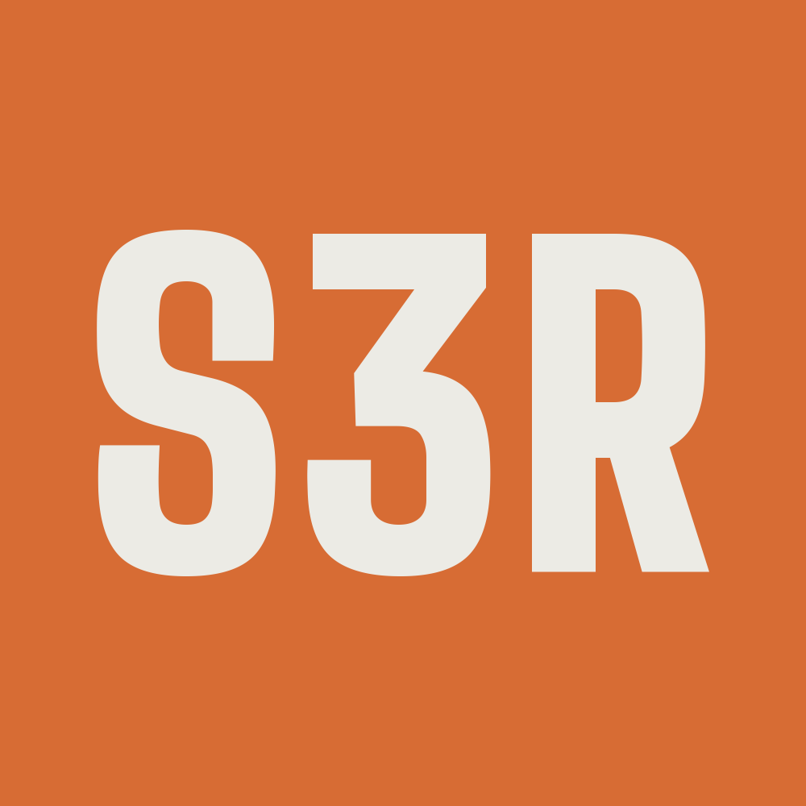

  

  

# Skate 3 Remaster

Built on the original [skate-3-rust-engine](https://github.com/SK8-ENGINE/skate-3-rust-engine) by
[chasmlol](https://github.com/chasmlol), [Hailey-Ross](https://github.com/Hailey-Ross),
[Ethanw05](https://github.com/Ethanw05) and [dylan-gluck](https://github.com/dylan-gluck). Thank you for the
foundation this project grew from.

**This is an unofficial fan project, not affiliated with or endorsed by EA. No game files are included, here or in
any download: you need your own copies of the games, and the launcher builds everything on your PC from them.**

A Rust and Bevy rewrite of Skate 3, built from reverse-engineering research, with Skate 1 and Skate 2's maps,
clothing, HUDs, challenges and online modes brought in. Skating, tricks, grinds, offboard movement, difficulty
settings and `.skate` map support. Gameplay parity is still a work in progress.

**Join the Discord:** https://discord.gg/PC2W9K4xan for help, news and finding people to skate with.

## Play

### What you need

- Windows 10 or 11, 64-bit, with a graphics card that has at least 4 GB of video memory.
- About **50 GB of free disk space** for the first build. The finished game takes about 14 GB; the rest is
  working space that is freed afterwards. Keep your game files on the same drive as the game if you can: from
  another drive some packages are copied instead of linked, so the build needs more space. Updates need about
  15 GB free.
- An internet connection for the first build. It downloads Java, unluac, vgmstream, ffmpeg and one public source
  file from Xenia's GitHub repository (for the disc decryption key). No game files are downloaded.
- Windows **long file paths** turned on. The launcher has a **Turn it on** button; Windows asks for an admin's
  permission once. On a standard user account, an admin has to do it.
- An XInput controller (an Xbox controller, for example).
- Your own copies of **all 18 source items**. Put them in one folder (subfolders are fine):

| # | Item |
|---|---|
| 1 | Skate 3 (USA, Europe), Xbox 360 ISO |
| 2 | Skate 3 Title Update 3 |
| 3 | Skate 3 DLC (9 packages): San Van Party Pack, Danny Way's Hawaiian Dream, Maloof Money Cup 2010 NYC, After Dark, Skate.Create Upgrade Pack, Black Box Distribution Skate Park, Filmer Pack, Skate Share Pack, Time is Money |
| 4 | Skate 2 (Europe), Xbox 360 ISO |
| 5 | Skate 2 DLC (3 packages): Maloof Money Cup Pack, Skate 2 Filmer Pack, Throwback Pack |
| 6 | Skate. (Europe), Xbox 360 ISO |
| 7 | RPCS3 New San Van mod (Skate 2 maps for Skate 3 PS3) |
| 8 | Skate1Map mod (Skate 1 map for Skate 3 PS3) |

The launcher recognises each item by its contents, so file names and folder layout don't matter. It tells you
exactly which items are missing or are a different version.

- Discs must be **`.iso` images** (plain or XGD). Extracted folders, Games on Demand copies, split ISOs and a
  `default.xex` on its own are not accepted.
- Skate 1 and Skate 2 must be the **European** discs. US discs show as "Not usable".
- The [game files guide](docs/source-files-guide.md) explains each item and what to do when one shows as Missing.

### Install

1. Unzip `Skate3Remaster-launcher.zip` into a folder of your own with the disk space (for example
   `C:\Games\Skate 3 Remaster`, not inside Program Files, where it can't update itself), and open
   **Skate 3 Remaster.exe**. The game is installed in a `game` folder beside it.
   - Windows may show **"Windows protected your PC"** because the launcher isn't code-signed yet. Click
     **More info → Run anyway**.
   - Some antivirus programs flag the build helper (`skate3setup.exe`) by mistake; it's a packaged Python
     program, which often triggers false alarms. Allow it, or the build can't run.
   - The launcher needs Microsoft Edge WebView2, which Windows 11 already has. On Windows 10 it tells you
     if it's missing.
   - Don't run the launcher as administrator. Files a build makes as administrator can't be changed by a
     normal run later, so the next build fails.
2. Press **Install** to download the game (about 100 MB).
3. Open **Files**, choose the folder with your 18 items, and press **Build**. The first build takes a while
   (75 minutes on a fast PC with an SSD). It can be stopped and continues where it left off.
4. Press **Play**.

### Updates

The launcher checks for a new release each time it opens; its **What's new** panel shows what
changed and how much the update downloads. Press **Update**, then **Build** if the update needs part of the game
rebuilt: only the parts that changed are rebuilt. To have this happen by itself, turn on **Settings → Install updates automatically**.

Your mods, settings and saves are kept across updates.

### Reporting problems

- **A build fails:** the launcher shows what went wrong. Press **Copy report** and paste it into a
  [GitHub issue](https://github.com/daytryan/S3R/issues) or ask on the
  [Discord](https://discord.gg/PC2W9K4xan).
- **The game crashes:** a window opens with **Send report**, **Copy report** and **Open folder**. Reports are saved
  in `%LOCALAPPDATA%\Skate3RustEngine\CrashReports`.
- **Questions or help:** ask on the [Discord](https://discord.gg/PC2W9K4xan); the blue **Discord** button on the
  launcher's left bar opens it too.
- Never attach ISOs, game files or anything else from the games to an issue.

**Privacy:** a crash report is sent only when you press **Send report**; nothing is uploaded otherwise. It goes to
the developers' Sentry project and holds the build number, the error and where it happened, your Windows version,
CPU, memory and graphics card, recent game log lines, the map and your game settings. Lines with folder paths or
account details are left out, player names, lobby IDs and addresses are not collected, and no user or machine ID is
sent. Details: [crash reports](docs/crash-reports.md).

### Skate 2 physics

**Settings → Gameplay → Physics** switches between Skate 3 and Skate 2 skating and tricks. It runs only on New San
Vanelona and only offline; on other maps the row is greyed out, and online it is hidden.

### Uninstall

In the launcher, open **Settings → Storage**:

- **Uninstall game** deletes the built game and the saved key, and keeps the launcher so you can build again.
- **Uninstall everything** does the same, then removes the launcher, its settings, logs, crash reports and desktop
  shortcut, and closes.

Both keep your saves, in the game folder's `data\settings`, and never touch your game files. Delete that folder
yourself if you don't want the saves. Crash reports are in `%LOCALAPPDATA%\Skate3RustEngine\CrashReports`
(Uninstall game leaves them).

### Controls

Use an XInput controller. Start (or Escape) opens Skate 3's original pause menu
with teleport, maps, difficulty, graphics and the other settings. Maps can be switched without restarting.

## Mods and agent authoring

Drop mod ZIPs into the `mods` folder beside the game and enable them in the Mods menu. **Point your coding agent
at [sdk/AGENTS.md](sdk/AGENTS.md)** to make a mod. See [package structure](docs/mod-packages.md),
[Lua API](docs/lua-modding.md), [vehicle API](docs/vehicle-sdk.md), [multiplayer mod SDK](docs/multiplayer-mods.md)
and [Mixamo workflow](docs/mixamo-vehicle-workflow.md). Editable examples live in `sdk/examples/`;
`tools/package_mod.py` validates and packages them.

## Build from source (developers)

Requires Windows, Rust with the MSVC toolchain, and LLVM installed in its default location. Run `BUILD.bat` to
build, then `PLAY.bat` to launch the test world. `PLAY.bat` opens your saved map (University by default); use the
in-game menu to switch maps, or drag a `.skate` file onto `PLAY.bat`. Development builds use a prepared asset set
in `assets/private/` or an installed asset directory.

### Releases

`scripts/Build-Release.ps1 -Build N -ReleaseKey <release-key.pem>` builds release number N (each must be higher
than the last one published; Python 3.12+ is needed). `-ReleaseKey` (or `SKATE_RELEASE_KEY`) is the owner's
ed25519 key, kept outside the repo; a release is refused without it, because the launcher only takes signed
releases. Story mode is left out unless you add `-StoryMode`. The packages go in `target/release-out`:

| File | What it is |
|---|---|
| `game.zip` | the game |
| `game.zip.sha256` | its SHA-256 |
| `Skate3Remaster-launcher.zip` | the launcher |
| `Skate3Remaster-launcher.zip.sha256` | its SHA-256 |
| `release.json` | the release's build number, files and their hashes |
| `release.json.sig` | the signature of `release.json` made with the release key |

The script refuses to finish if:

- any packaged file is identical to a file from the source games, DLC or mods, or carries a personal path
  (set `SKATE_SOURCES` to the source folder for the full check);
- the build helper can't load every module or engine file its build scripts use.

Publishing is done by hand: a GitHub release (not a draft or pre-release) with all six files attached. The
launcher needs `game.zip`, `Skate3Remaster-launcher.zip`, `release.json` and `release.json.sig`; the `.sha256`
files are for people who download by hand. The manual GitHub Actions workflow builds the same packages without
the source-file part of the check, and without a signature.

Custom animations and climbing support remain available, but no custom clips are shipped. The included
format-demo map is original procedural content.

Implementation notes are in [`docs/`](docs/). Patched Bevy dependencies and their licenses are in
[`vendor/`](vendor/).

## Advanced diagnostics

Windows builds support opt-in [performance timeline capture](docs/performance-tracing.md) through the `--trace`
CLI option, including optional GPU pass diagnostics.

## License

The project's own code is under the [MIT License](LICENSE). Third-party code keeps its own license (see
[`docs/THIRD_PARTY_NOTICES.md`](docs/THIRD_PARTY_NOTICES.md)). No game content is included or licensed: you need
your own copies of the games.
